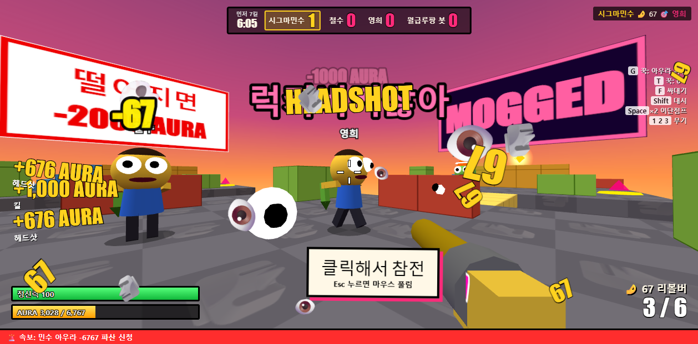

# 🗿 AURA FARM 6767

맞으면 눈깔이 튀어나오고, 총 쏘면 방귀 소리가 나고, 가만히 서서 아우라를 파밍하는 **병맛 멀티 FPS (최대 6인, 5분 데스매치)**.
브라우저로 돌아가고, 내 컴퓨터가 서버가 된다.



언어: 영어가 기본이고, 첫 화면 오른쪽 아래에서 KR로 바꿀 수 있다.

## 바로 하기 (설치 없음)

**<https://dinored960018.github.io/aura-farm-6767/>**

방을 만들면 **주소창 링크가 곧 초대 링크**가 된다. 그대로 복사해서(또는 대기실의 **🔗 초대**) 친구에게 보내면 그 방으로 바로 들어온다. 공유기가 달라도 된다.

- 방장의 브라우저가 서버 역할을 하니까 방장이 창을 닫으면 게임이 끝난다.
- 친구 연결은 WebRTC이고, 처음 서로를 찾을 때만 무료 공개 서버(PeerJS)를 쓴다. 그 서버가 죽었거나 회사·학교처럼 막힌 망이면 초대가 안 될 수 있다. 봇전은 항상 된다.

## 내 컴퓨터에서 서버 돌리기

같은 공유기에서 더 안정적으로 하고 싶을 때.

[Node.js](https://nodejs.org) 20 이상이 필요하다.

```bash
git clone https://github.com/dinored960018/aura-farm-6767.git
cd aura-farm-6767
npm install
npm start
```

Windows면 `start.bat`을 더블클릭해도 된다.

- 나: <http://localhost:6767>
- 친구: 서버 창에 뜨는 `http://192.168.x.x:6767` (같은 와이파이/공유기)

### 친구가 접속이 안 되면

Windows 방화벽이 막은 경우가 많다. 관리자 권한 PowerShell에서 한 번만 실행한다.

```powershell
New-NetFirewallRule -DisplayName "AURA FARM 6767" -Direction Inbound -Protocol TCP -LocalPort 6767 -Action Allow -Profile Private
```

## 흐름

방 만들기 → **대기실**(맵·캐릭터 고르기, 채팅, 준비) → 2~6명 전원 준비하면 경기 → 5분 데스매치 (킬 많은 순, 같으면 덜 죽은 순) → 결과 화면 → **다시 대기실로 복귀**(승수 유지) → 또 준비하면 재경기.

사람이 모자라면 대기실의 봇 **+** 버튼으로 채운다.

**모드**: 기본(5분 데스매치) · 각성 난장판(아우라 3배, 반쯤 찬 채로 시작).

## 크레이지게임즈 버전

`npm run build:crazygames`로 `aura-farm-6767-crazygames.zip`을 만든다.

- **공개 매칭**: 서버 없이 정해 둔 방 번호 PUB01~PUB16을 두드려 열린 방에 들어가고, 없으면 내가 방장이 된다. 공개 방은 경기 중에도 봇 자리로 바로 난입하고, 사람이 나가면 봇이 채우며, 한 판 끝나면 15초 뒤 자동으로 다음 판.
- 친구와 바로 하기와 초대 링크는 비공개 방.
- 경기 사이 광고, 채팅 끄기·음소거 설정, 로그인 닉네임, 욕설 필터.

## 진행과 상점

- 판이 끝나면 킬·승리·아우라로 **코인과 경험치**. 처음엔 캐릭터 4명, 레벨 2~9에서 나머지 10명이 열린다.
- **오늘의 미션** 3개(날짜마다 바뀜)를 깨면 코인.
- **상점**: 모자 6종, 얼굴 4종. 겉모습만 바뀌고 다른 사람에게도 보인다.
- 저장은 브라우저(크레이지게임즈에서는 SDK 저장소, 로그인하면 기기 사이 동기화).

## 휴대폰

왼쪽 엄지로 이동, 오른쪽을 끌어 시점, 버튼으로 발사·점프·대시·싸대기·각성·무기·조준·파밍. 발사 버튼을 누른 채 끌면 쏘면서 돌아간다. 가로 화면 전용.

## 맵

| 맵 | 특징 |
| --- | --- |
| 🕳️ 오하이오 구덩이 | 가운데 구멍, 점프대로 올라가는 공중 명당 |
| 🌆 시그마 옥상 | 벽 없음. 다리와 점프대로 옥상을 건너고, 밀리면 추락 |
| 🏢 백룸 사무실 | 좁은 복도와 샷건. 점프대로 천장 위 2층에 올라감 |
| 🚣 아우라 보트 | 배 세 척과 널빤지 다리. 물에 빠지면 끝 |
| 🚻 거대 화장실 | 칸막이 사이 숨바꼭질과 대왕 변기 |
| 🏟️ 67 콜로세움 | 기둥 숲, 가운데 피라미드, 2층 관중석 |
| 🍱 급식실 | 식탁 엄폐, 교실 창문 넘기, 계단으로 옥상 저격 |
| 🛒 마트 | 키 큰 진열대 골목, 냉동 코너, 하역장 트럭 |
| 🎲 랜덤 | 시작할 때 지난 판과 다른 맵으로 |

## 캐릭터별 각성

아우라 6,767을 채우고 E.

| 캐릭터 | 각성 | 내용 |
| --- | --- | --- |
| 😐 민수 | 눈깔 레이저 | 6.7초간 눈에서 레이저, 탄창 무한 |
| 🗿 시그마 | 시그마 각성 | 이동 1.4배, 데미지 1.67배, 탄창 무한, 왕관 |
| 😼 킹받는 고양이 | 냥냥 급습 | 총알 무시하고 제일 가까운 상대에게 덮침. 덮칠 때 한 방, 붙어서 할큄. 싸대기 맞으면 튕겼다가 다음 얼굴로 |
| 🛸 오하이오 주민 | 핵 모드 | 조준한 곳에 핵. 2.6초 뒤 번쩍, 정적, 쾅. 벽 뒤면 데미지 절반, 쏜 사람은 면역 |
| 🚽 변기맨 | 대물내림 | 5초간 주변을 빨아들이고 코앞이면 갈아버림 |
| 🎙️ 짖는 스트리머 | 짖기 방송 | 6번 짖어서 앞쪽 상대를 날려버림 |
| 🪵 퉁퉁퉁 사후르 | 사후르 타임 | 퉁! 퉁! 퉁! 7번의 충격파로 주변을 띄움 |
| 🦸 메가브로 | 메가 펀치 | 벽 뚫고 날아가 상대 셋을 차례로 관통 |
| 😏 리즈왕 | 리즈 매혹 | 주변 상대가 3.5초간 나한테 걸어오고 공격 못 함 |
| 🐕 칠가이 | 완전 칠함 | 5초간 무적, 주변 상대는 느려짐 |
| 🍌 바나나 고양이 | 바나나 폭격 | 앞으로 껍질 6개. 밟으면 미끄러져 날아가고 느려짐 |
| 🦝 페드로 너구리 | 페드로 댄스 | 주변 전원 강제로 춤. 춤추는 동안 공격 못 하고 체력이 깎임 |
| 🗿 뮤잉남 | 모깅 | 바라보는 상대의 체력과 아우라를 계속 뺏음 |
| 🩰 발레리나 카푸치나 | 카푸치노 회전 | 빠르게 돌며 닿는 상대를 갈고 튕겨냄 |

## 조작

| 키 | 동작 |
| --- | --- |
| WASD | 이동 |
| Space | 점프 (공중에서 한 번 더) |
| Shift | 대시 |
| 좌클릭 / 우클릭 | 발사 / 줌 (저격총은 조준경) |
| R | 장전 |
| 1 2, Q, 휠 | 주무기 / 보조무기 교체 |
| Tab | 전체 점수판 |
| F | 싸대기 (67 데미지, 상대를 날려버림) |
| G 꾹 | 아우라 파밍 |
| T 꾹 | 6-7 |
| E | 아우라가 가득 차면 캐릭터별 각성 |
| M | 음소거 |

## 들어 있는 것

- **무기**: 대기실에서 주무기 하나 + 보조무기 하나를 고른다.
  - 주무기: 💨 방귀 기관총(67발) · 📢 바인붐 샷건 · 🎯 모깅 저격총(조준경, 머리 한 방) · 🧊 드라이아이스 런처(터지면 주변 데미지 + 느려짐)
  - 보조무기: 🤌 67 리볼버(머리 67, 몸 33.5) · 🔫 쌍권총(양손 번갈아)
- **눈깔**: 맞으면 상대 눈이 용수철처럼 튀어나오고, 내가 맞으면 내 화면에 눈이 튀어나온다. 죽으면 눈알이 빠져서 바닥을 굴러다닌다.
- **아우라**: 헤드샷 +676, 킬 +1000, 사망 -1000, 추락 -2000, 파밍 중 처맞으면 -676.
- **개인전 킬 판정**: 혼자 떨어져 죽어도 8초 안에 나를 때린 사람이 있으면 그 사람 킬.
- **랜덤 이벤트**: 🐶✈️ 개 전투기 공습 · 6️⃣7️⃣ 모든 데미지 67 · 🗿 대두 시대 · 🌙 저중력
- **효과음**: 음원 파일 없이 전부 코드로 합성했다(방귀, 쿵, 에어혼, 쇠파이프, 슬픈 트롬본, 꽥꽥 발소리, phonk풍 음악). 음성은 브라우저 내장 TTS라 컴퓨터마다 다르게 들린다.
- **경기장**: 가운데 구멍으로 떨어지면 오하이오로 추락한다. 점프대, 계단, 탑, 치킨, 아우라 결정.

## 구조

```
server/   방·경기 판정(서버가 체력과 명중을 결정), 봇과 길찾기, 정적 파일 + WebSocket
shared/   서버와 브라우저가 같이 쓰는 숫자, 맵 3개, 이동 물리
public/   화면 (three.js), 효과음 합성, HUD
test/     실제 서버를 띄워 WebSocket으로 경기를 끝까지 돌리는 테스트
```

`npm test`로 테스트를 돌린다. 같은 공유기 안에서 친구끼리 노는 용도라 로그인도 치트 방지도 없다. 인터넷에 그대로 공개하지 말 것.

## 라이선스

MIT. 등장하는 밈 문구는 패러디이고, 원곡이나 원본 음원은 들어 있지 않다.
